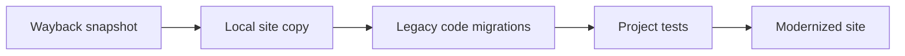

<p align="center">
	<strong>OLDWEBSITES</strong><br>
	Recover an archived site. Bring its code forward.
</p>

<p align="center">
	
	
	
</p>

> **Beta / ongoing work.** This toolkit is evolving. Preview transformations, review the diff, and run the site's tests before deploying.

## The workflow



## Quick start

Install the migration tools once from the repository root:

```sh
npm install
composer install
```

Download a snapshot. The default is the latest available capture; use `--year` to select a year:

```sh
python3 scripts/restore_site.py https://example.com --year 2004 --output recovered/example
```

Preview migrations, then apply them with the site's test command:

```sh
python3 scripts/modernize_code.py recovered/example
python3 scripts/modernize_code.py recovered/example --write --test-command "npm test"
```

`--write` creates a backup first and rolls source files back if a converter or test fails. The backup location is printed by the command.

## What gets modernized

| Source     | Migration path                                                                                                     | Configuration                |
| ---------- | ------------------------------------------------------------------------------------------------------------------ | ---------------------------- |
| JavaScript | Supported ES3/ES5 patterns to modern ES6; ESLint checks against the latest ECMAScript and applies modern autofixes | `eslint.config.mjs`          |
| PHP        | Rector upgrades to PHP 8.5 by default; targets 8.1 through 8.5 are selectable                                      | `rector.php`, `--php-target` |
| CSS        | PostCSS transforms configured properties, values, and declarations; Prettier formats the result                    | `css_migrations.json`        |
| HTML       | Converts configured legacy elements and attributes, normalizes to HTML5, then formats                              | `html_migrations.json`       |

CSS and HTML rules are editable per site. For example, a CSS migration can replace a vendor-prefixed property, a value, or a full declaration:

```json
{
  "properties": { "-webkit-border-radius": "border-radius" },
  "values": { "#f00": "#c00" },
  "declarations": {
    "filter": {
      "alpha(opacity=50)": { "property": "opacity", "value": "0.5" }
    }
  }
}
```

The starter HTML profile upgrades common presentation markup such as `center`, `font`, `strike`, and `big`. Literal old-to-new values can also be replaced across PHP, JavaScript, CSS, HTML, TypeScript, JSON, SVG, and other supported text files:

```sh
python3 scripts/update_assets.py recovered/example --mapping replacements.json
python3 scripts/update_assets.py recovered/example --mapping replacements.json --write
```

## Scope

- The Wayback downloader inventories archived URLs for the starting hostname and follows references in HTML and CSS. Use `--max-files` to set an optional download limit.
- Wayback captures rendered pages, not server-side PHP source. PHP conversion needs the original source checkout or a backup.
- JavaScript and PHP converters only transform patterns supported by their rules. CSS and HTML standards evolve rather than having a single universal “latest version.” Review changes and test behavior before release.
